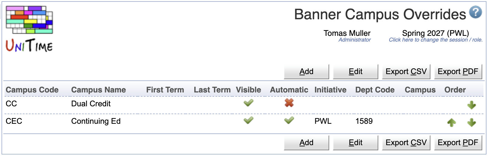
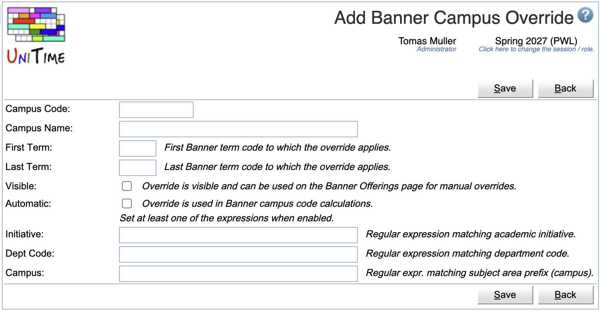
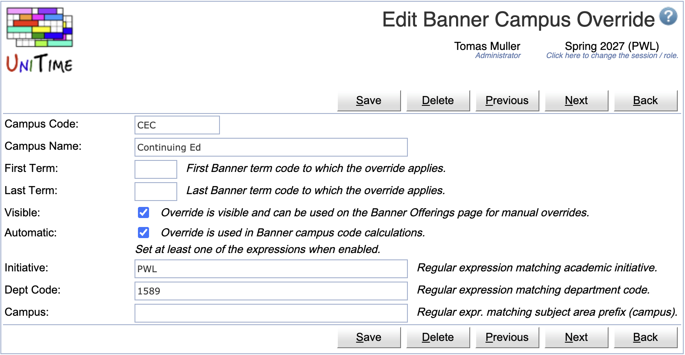

## Screen Description

This page allows configuring campus override options for the [Banner Offering Edit](banner-offering-edit) page.

{:class='screenshot'}

## Details

* **Campus Code**
	* The code used in Banner to identify the campus

* **Campus Name**
	* Name for the Banner campus override

* **First Term**
	* First Banner term code to which the override applies.

* **Last Term**
	* Last Banner term code to which the override applies.

* **Visible**
	* Banner campus overrides that are marked as NOT visible do not show in the drop-down of available campus overrides unless the section already has the override (used on the [Banner Offering Edit](banner-offering-edit) page)

* **Automatic**
	* Check to enable this campus override in the default Banner campus code calculation.
	* If enabled, set at least one of the following expressions (Initiative, Dept Code, and/or Campus).

* **Initiative**
	* Regular expression matching academic initiative.
	* Prefix with ! for a negation, i.e., matching all academic sessions where the academic initiative does not match the provided regular expression.

* **Dept Code**
	* Regular expression matching department code of the managing department of the class.
	* Prefix with ! for a negation, i.e., matching all departments where the department code does not match the provided regular expression.

* **Campus**
	* Regular expression matching subject area prefix (campus). 
	* To be used when subject areas are prefixed by the term code (**Use Subject Area Prefix As Campus** is checked on [Banner Sessions](banner-sessions) page)
	* Prefix with ! for a negation, i.e., matching all subject areas where the campus does not match the provided regular expression.

### Additional Notes

* Automatic rules are used when `tmtbl.banner.campus.element.helper` is set to [DefaultExternalBannerCampusCodeElementHelper](https://github.com/UniTime/unitime-addons/blob/master/BannerAddOn/JavaSource/org/unitime/banner/util/DefaultExternalBannerCampusCodeElementHelper.java) in the [custom properties](installation.md#custom-properties), e.g., using the [Application Configuration](application-configuration) page.
	```
	tmtbl.banner.campus.element.helper=org.unitime.banner.util.DefaultExternalBannerCampusCodeElementHelper
	```

* For the automatic rules, the order of the overrides is considered as well, and the first matching rule applies. Use the  up and  down arrows to change the order of the overrides.


## Operations

Click a table header to sort the table by the given column. Second click on the same header will reverse the order.

### Add Banner Campus Override

Click **Add Campus Override** to create a new campus override option

{:class='screenshot'}

* Click **Save** to create a new Banner campus override
* Click **Back** to go back to the list of campus overrides without making any changes

### Edit Banner Campus Override
Click a line to update an existing campus override or delete it

{:class='screenshot'}

* Click **Update** to update the campus override
* Click **Delete** to delete the campus override. Only overrides that are not being used can be deleted.
* Click **Back** to go back to the list of campus overrides without making any changes